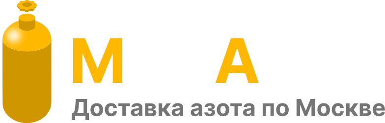

<div align="center">



# МосАзот

**Telegram Mini App интернет-магазина с режимами покупки и обмена**

[Возможности](#возможности) · [Как устроен проект](#как-устроен-проект) · [Техническая реализация](#техническая-реализация) · [Запуск](#запуск) · [Моя роль](#моя-роль)

</div>

## О проекте

Я разработал МосАзот для того же заказчика, для которого ранее создал МосАлко. Это отдельный MVP интернет-магазина с другим дизайном, ассортиментом и частью бизнес-логики. Архитектурно проекты похожи: пользовательский Telegram Mini App, административная панель, API, база данных, Redis и Telegram-бот.

После МосАлко я уже имел готовую проверенную основу, поэтому МосАзот разработал примерно за **две недели**. Я адаптировал предметную модель и интерфейс под новый продукт, развернул проект в production и передал его заказчику. По его отзыву, приложение работает стабильно и без нареканий.

## Возможности

### Пользовательская часть

- главная страница с основным ассортиментом и дополнительными товарами;
- карточки товаров с вариантами, изображениями и ценами;
- отдельные режимы **покупки** и **обмена** для основного товара;
- корзина с изменением количества и удалением позиций;
- сценарий «Купить сейчас»;
- оформление заказа с адресом, телефоном, комментарием и промокодом;
- профиль пользователя, адреса, история и повтор заказа;
- мобильная навигация и Telegram WebApp feedback-взаимодействия.

### Административная панель

- авторизация и проверка уровня доступа;
- управление товарами, категориями, характеристиками и изображениями;
- просмотр заказов и пользователей;
- управление промокодами и системными параметрами;
- статистика по пользователям, заказам и содержимому корзин.

### Telegram-бот

В backend есть отдельный Telegram-бот для системных уведомлений. Бот запускается как отдельный контейнер и использует общую конфигурацию проекта, не смешивая фоновые задачи с HTTP-процессом API.

## Как устроен проект

```text
frontend/  пользовательский Telegram Mini App
admin/     панель управления магазином
backend/   API, бизнес-логика, бот и миграции базы данных
```

Frontend получает данные через FastAPI API. Запросы проходят авторизацию и валидацию, затем обрабатываются сервисным слоем и репозиториями. PostgreSQL хранит каталог, пользователей, корзины и заказы; Redis используется для кэша справочных и часто запрашиваемых данных.

Для МосАзота я сохранил общие технические подходы МосАлко, но отдельно реализовал сценарий выбора размера/варианта товара и переключения между покупкой и обменом. Это позволило переиспользовать надежную основу, не превращая новый проект в копию предыдущего.

## Техническая реализация

### Backend

- Python и FastAPI;
- асинхронный PostgreSQL-доступ через SQLAlchemy и asyncpg;
- Pydantic-схемы для контрактов API;
- доменные модули `auth`, `users`, `products`, `orders` и `admin`;
- сервисный слой, репозитории и Unit of Work;
- Alembic-миграции;
- Redis-кэширование через `fastapi-cache`.

### Авторизация

Пользовательская сессия начинается с проверки Telegram WebApp init data. После этого backend выдает access JWT, а refresh-токен хранится в защищенной HttpOnly cookie. Административный login-flow отделен от пользовательского и дополнительно проверяет уровень доступа перед изменением данных магазина.

### Frontend и admin

Клиент и панель управления написаны на TypeScript, React и Next.js 14. Tailwind CSS отвечает за визуальную систему, Axios — за API-запросы, Zustand — за локальное состояние корзины и пользователя. Основные пользовательские разделы вынесены в отдельные страницы и компоненты, поэтому сценарии каталога, товара, корзины, профиля и заказов развиваются независимо.

### DevOps и деплой

Я подготовил Dockerfile и Docker Compose для frontend, admin и backend-контура с Redis, а также отдельного контейнера бота. Секреты и подключения задаются через окружение. Это дает воспроизводимый запуск и позволяет переносить проект между окружениями без изменения исходного кода.

## Запуск

Для frontend или admin:

```bash
cd frontend # или cd admin
npm ci
npm run dev
```

Production-сборка:

```bash
npm run build
npm start
```

Backend и Redis:

```bash
cd backend
docker compose up --build
```

Для запуска требуются переменные PostgreSQL, Redis, Telegram и JWT. Production-значения в репозиторий не включены.

## Моя роль

Я самостоятельно сделал frontend, полную административную панель, backend API, Telegram-бота, интеграцию, контейнеризацию и деплой. Проект создавался на основе опыта МосАлко, поэтому основное внимание я уделил адаптации продукта: новому дизайну, ассортименту и логике покупки/обмена.

После передачи проекта заказчику доступа к его production-инфраструктуре у меня не было. README отражает код и техническую структуру, доступные в репозитории.
